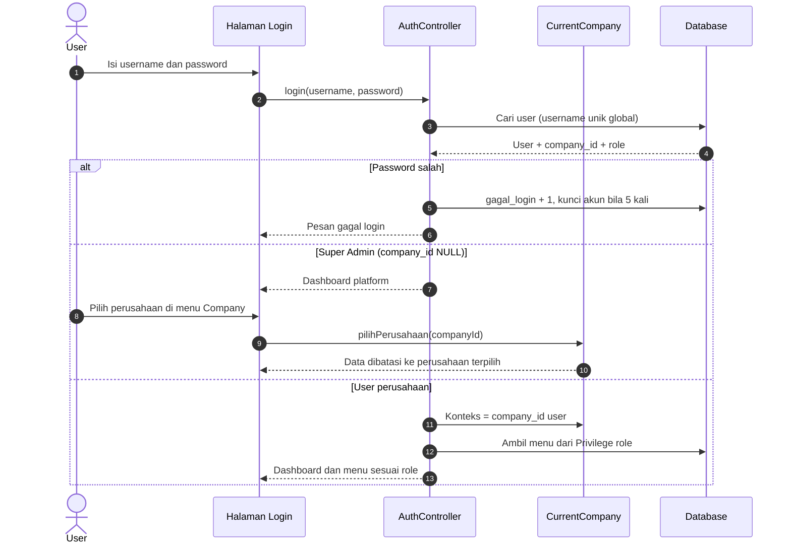
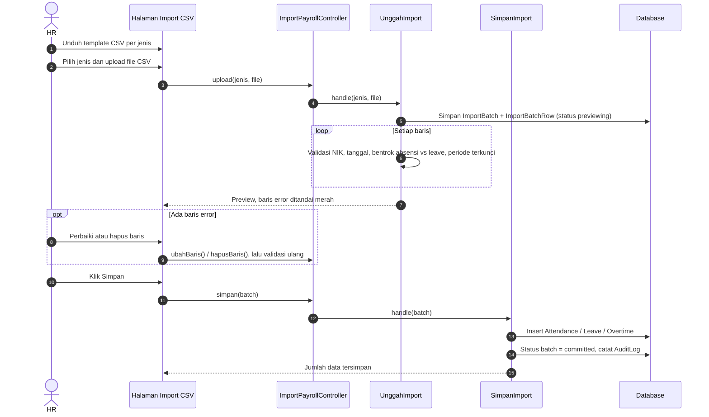
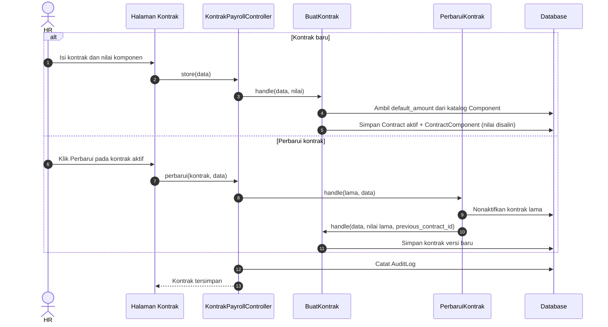
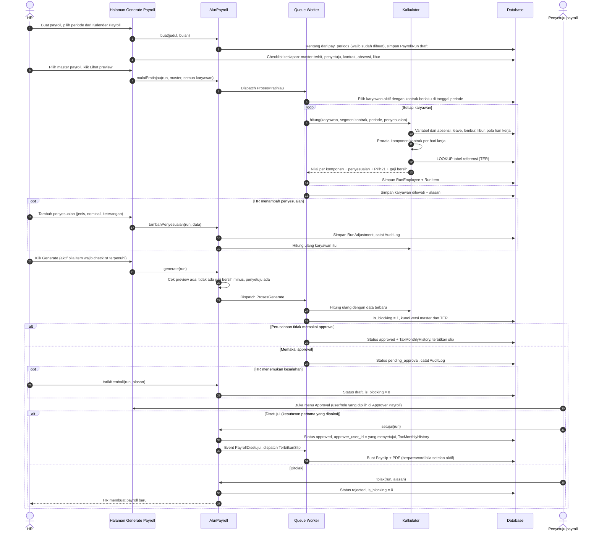
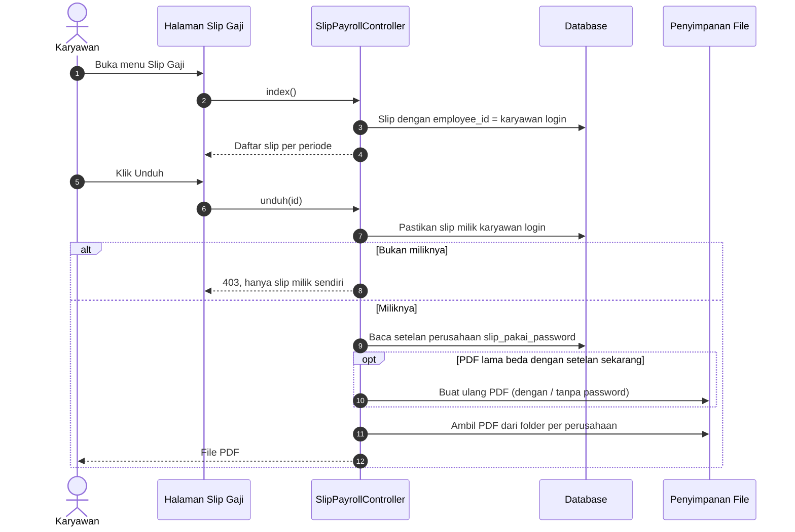

# Sequence diagram (Mermaid)

Alur mengikuti kode branch `feature/multi-tenant-payroll`. Cara buka di draw.io: Arrange > Insert > Advanced > Mermaid, lalu tempel salah satu blok di bawah.

## 1. Login dan pemilihan perusahaan

## 2. Import CSV absensi, leave, dan lembur

## 3. Membuat dan memperbarui kontrak

## 4. Generate dan approval payroll

## 5. Karyawan mengunduh slip gaji

