# UML Aplikasi Penggajian Karyawan, versi multi-perusahaan (Mermaid)

Diagram ini mengikuti kode di branch `feature/multi-tenant-payroll`. Versi lama (sebelum multi-perusahaan) disimpan di folder `arsip-v1-sebelum-multi-tenant`.

Yang berubah dari versi lama:
- Satu aplikasi melayani banyak perusahaan. Semua data punya `company_id`, dan Super Admin membuat perusahaan beserta akun Admin-nya.
- Rumus gaji tidak lagi ditulis di kode. HR menyusun master payroll berversi (variabel, parameter, komponen); PPh 21 TER/Desember dihitung otomatis dari tabel referensi nasional.
- Kontrak berversi dan dipilih dari tanggal berlakunya; gaji dari kontrak diprorata per hari kerja untuk karyawan baru/resign/ganti kontrak.
- Kalender Payroll: periode per bulan yang selalu menyambung, hari libur (nasional, cuti bersama, perusahaan, khusus departemen), dan pola hari kerja per departemen/karyawan.
- Absensi, leave, dan lembur masuk lewat form atau import CSV dengan preview baris error.
- Payroll: buat dari periode, checklist kesiapan, preview semua karyawan (queue), penyesuaian (bonus/THR/reimburse/koreksi), generate (queue), approval oleh Manager di departemen HR (setelan Admin: pakai approval atau langsung final), tarik kembali, batalkan proses macet, lalu slip PDF (password opsional).

Mermaid tidak punya tipe use case dan activity diagram, jadi keduanya digambar dengan flowchart. Untuk draw.io: Arrange > Insert > Advanced > Mermaid, lalu tempel satu blok.

## 1. Use Case Diagram
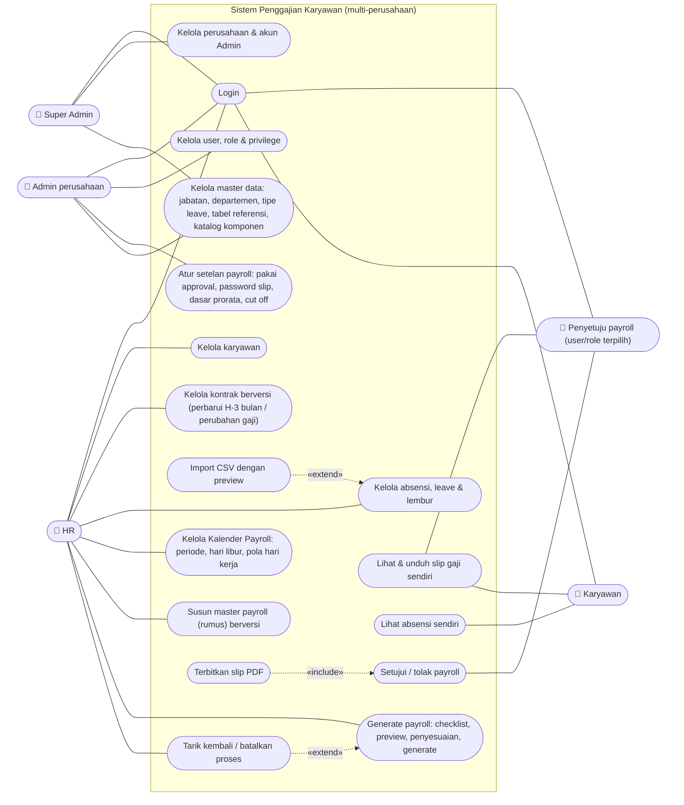

## 2. Activity Diagram: Import CSV absensi, leave, dan lembur
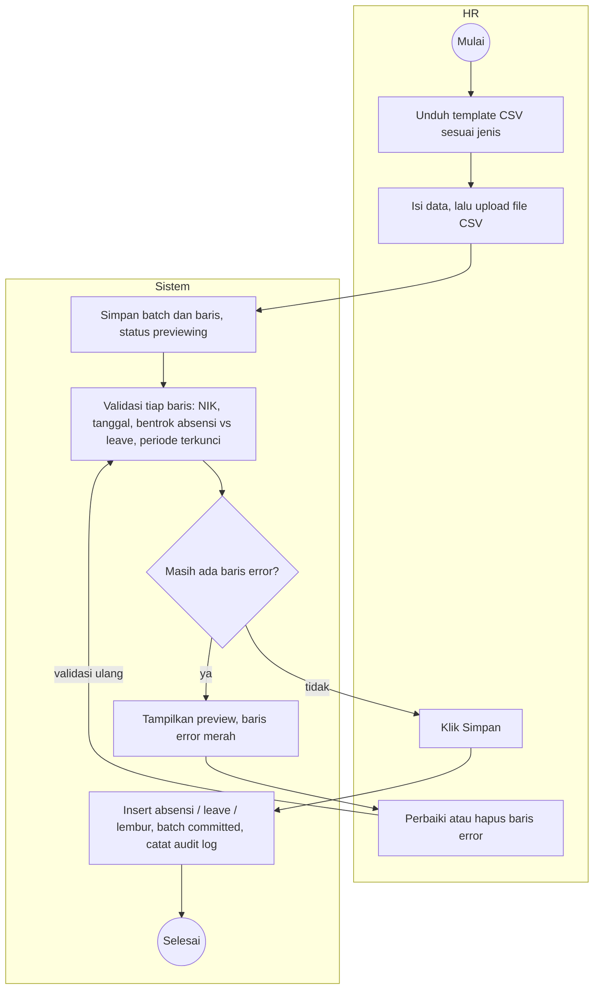

## 3. Activity Diagram: Kontrak berversi
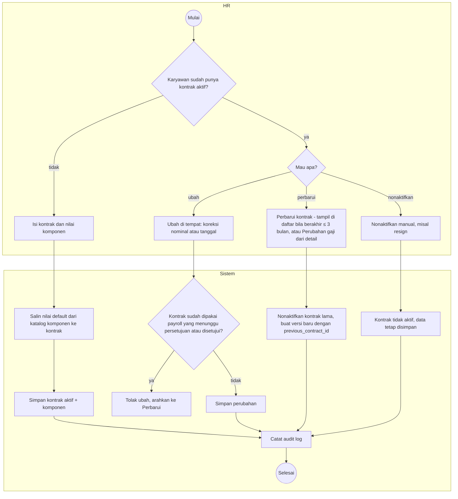
Saat payroll dihitung, kontrak dipilih dari tanggal berlakunya (kontrak aktif + kontrak lama yang sudah diperbarui) dan dipotong per segmen (masuk, resign, akhir kontrak, ganti kontrak). Komponen pendapatan dari kontrak dibayar `nilai × hari kerja segmen ÷ hari kerja periode`.

## 4. Activity Diagram: Menyiapkan master payroll dan Kalender Payroll
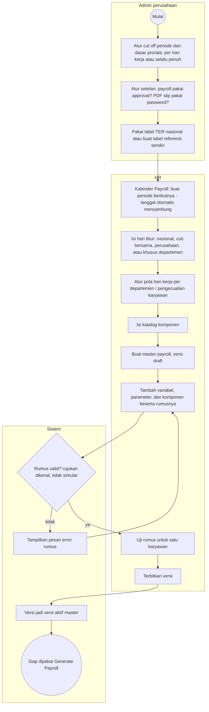
Aturan Kalender Payroll: periode baru mulai sehari setelah periode sebelumnya; tanggal selesai bisa diubah selama periode belum diproses (periode berikutnya ikut bergeser); hanya periode terakhir yang belum diproses yang bisa dihapus; hari libur di periode yang payroll-nya menunggu persetujuan/final terkunci. Status periode: Belum diproses, Draft payroll, Menunggu persetujuan, Final.

## 5. Activity Diagram: Generate dan approval payroll
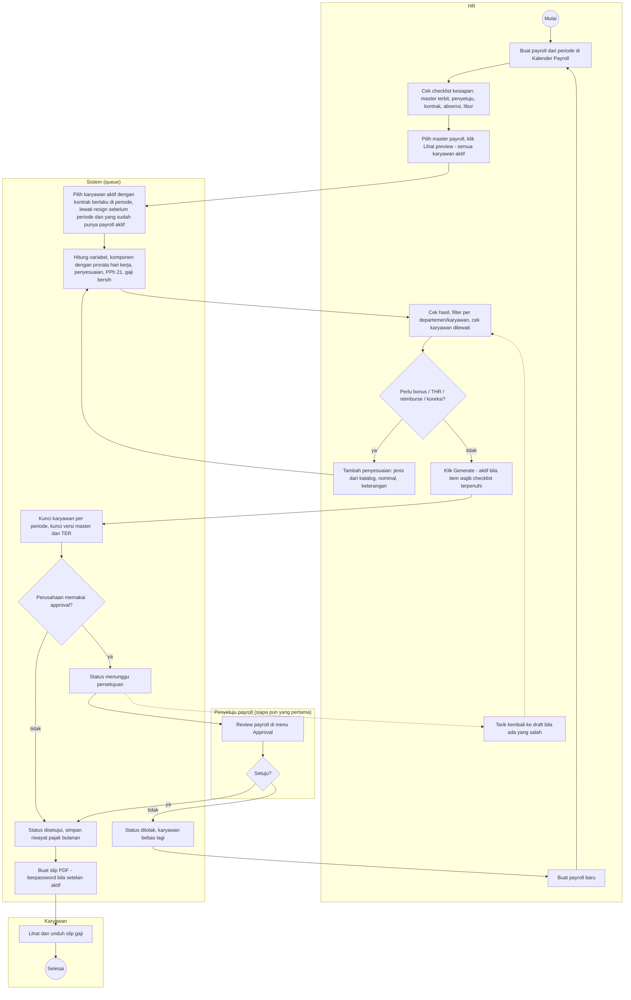
Proses yang macet lebih dari 15 menit bisa dibatalkan HR (kembali ke draft). Payroll final tidak diubah; koreksinya lewat penyesuaian di payroll periode berikutnya.

## 6. Class Diagram

```mermaid
---
title: Class Diagram - Aplikasi Penggajian Karyawan (Multi-Perusahaan)
---
classDiagram
  class Company {
    -int id
    -String code
    -String name
    -String signer_name
    -String signature_path
    -bool payroll_baru
    -bool payroll_butuh_approval
    -bool slip_pakai_password
    -String prorata_dasar
    -bool is_active
    +aktifkanPayroll() void
  }
  class User {
    -int id
    -int company_id
    -String username
    -String password
    -bool is_active
    -bool is_locked
    +login() bool
    +pilihPerusahaan(companyId) void
  }
  class Role {
    -int id
    -int company_id
    -String nama
  }
  class Menu {
    -int id
    -int parent_id
    -String nama
    -String url
  }
  class Privilege {
    -int id
    -int role_id
    -int menu_id
    -bool can_view
    -bool can_create
    -bool can_update
    -bool can_delete
    -bool can_approve
    +cekAkses(role, menu, aksi) bool
  }
  class Departemen {
    -int id
    -int company_id
    -String kode
    -String nama
    -int pay_work_pattern_id
  }
  class WorkPattern {
    -int id
    -String code
    -String name
    -String work_days
    -bool is_default
    +hariUntuk(polaKaryawan, polaDepartemen) int[]
  }
  class Holiday {
    -int id
    -Date holiday_date
    -String type
    -int departemen_id
    -String name
  }
  class PayPeriod {
    -int id
    -String period_month
    -Date start_date
    -Date end_date
    +status() String
  }
  class KelolaPeriode {
    +untukBulan(bulan) PayPeriod
    +buatBerikutnya() PayPeriod
    +ubahSelesai(periode, tanggal) void
    +hapus(periode) void
  }
  class Employee {
    -int id
    -int company_id
    -String nik
    -String nama
    -int position_id
    -int pajak_id
    -bool has_npwp
    -String bank_account_no
    -Date tgl_masuk
    -Date resign_date
    -int pay_work_pattern_id
    -bool is_active
    +employeeNo() String
    +ptkpStatus() String
    +hariKerja() int[]
  }
  class Position {
    -int id
    -String code
    -String name
  }
  class Component {
    -int id
    -String code
    -String name
    -String type
    -bool is_taxable
    -bool is_tax_deductible
    -bool is_contractable
    -decimal default_amount
  }
  class Contract {
    -int id
    -int employee_id
    -int previous_contract_id
    -Date start_date
    -Date end_date
    -bool is_active
    +perbarui(data) Contract
    +nonaktifkan() void
    +hampirBerakhir() bool
  }
  class KontrakPeriode {
    -array segmen
    +untuk(employee, mulai, selesai) KontrakPeriode
    +terakhir() Contract
    +penuh() bool
  }
  class ContractComponent {
    -int id
    -int contract_id
    -int component_id
    -decimal amount
  }
  class Attendance {
    -int id
    -int employee_id
    -Date attendance_date
    -Time check_in
    -Time check_out
    -decimal late_hours
  }
  class Leave {
    -int id
    -int employee_id
    -int leave_type_id
    -Date leave_date
  }
  class Overtime {
    -int id
    -int employee_id
    -Date overtime_date
    -decimal duration_hours
  }
  class ImportBatch {
    -int id
    -String type
    -int total_rows
    -int valid_rows
    -String status
    +unggah(file) ImportBatch
    +validasiUlang() ImportBatch
    +simpan() int
  }
  class ReferenceTable {
    -int id
    -int company_id
    -String code
    -String name
    +isNasional() bool
  }
  class ReferenceTableVersion {
    -int id
    -int version_no
    -Date effective_from
    -DateTime locked_at
    +terbitkan(berlakuMulai) void
    +salin() ReferenceTableVersion
  }
  class Master {
    -int id
    -String code
    -String name
    -int current_version_id
  }
  class MasterVersion {
    -int id
    -int version_no
    -String status
    -DateTime locked_at
    +terbitkan() void
    +salin() MasterVersion
  }
  class Variable {
    -int id
    -String code
    -String kind
    -String source
    -String aggregate
    -String formula
  }
  class Param {
    -int id
    -String code
    -decimal value
  }
  class Item {
    -int id
    -String code
    -String type
    -String calc_type
    -String formula
    -String item_role
    -int sort_order
  }
  class PeriodConfig {
    -int start_day
    -int end_day
    -bool start_in_previous_month
    +rentang(periode) Date[]
  }
  class Kalkulator {
    +hitung(employee, kontrakPeriode, mulai, selesai, penyesuaian) HasilHitung
    -prorata(periode) decimal[]
  }
  class PenyetujuPayroll {
    +boleh(user) bool
    +daftar() User[]
  }
  class PayrollRun {
    -int id
    -String title
    -Date period_start
    -Date period_end
    -String status
    -String job_status
    -int approver_user_id
    -bool is_blocking
    +mulaiPratinjau(master) void
    +tambahPenyesuaian(data) RunAdjustment
    +generate() void
    +setujui(user) void
    +tolak(user, alasan) void
    +tarikKembali(alasan) void
    +batalkanProses() void
  }
  class RunAdjustment {
    -int id
    -int run_id
    -int employee_id
    -int component_id
    -decimal amount
    -String note
  }
  class RunEmployee {
    -int id
    -int employee_id
    -int contract_id
    -bool is_blocking
    -decimal total_earnings
    -decimal total_deductions
    -decimal take_home_pay
  }
  class RunItem {
    -int id
    -String code
    -decimal calculated_amount
    -decimal final_amount
    -bool is_taxable
  }
  class Payslip {
    -int id
    -int run_employee_id
    -String file_path
    -DateTime generated_at
    +buatPdf() void
    +password() String
    +pakaiPassword() bool
  }
  class TaxMonthlyHistory {
    -int id
    -int tax_year
    -int tax_month
    -decimal gross_taxable
    -decimal pph21
  }
  class AuditLog {
    -int id
    -String action
    -String entity_type
    -int entity_id
  }
  Company "1" *-- "0..*" User : punya
  Company "1" *-- "0..*" Employee : punya
  Company "0..1" *-- "0..*" ReferenceTable : NULL = nasional
  Role "1" --> "0..*" User : dimiliki
  Role "1" *-- "0..*" Privilege
  Menu "1" *-- "0..*" Privilege
  User "0..1" --> "0..1" Employee : akun
  PenyetujuPayroll ..> PayrollApprover : user/role terpilih
  Departemen "0..*" --> "0..1" WorkPattern : pola hari kerja
  Employee "0..*" --> "0..1" WorkPattern : pengecualian
  Departemen "0..1" o-- "0..*" Holiday : libur khusus
  Company "1" *-- "0..*" PayPeriod : Kalender Payroll
  KelolaPeriode ..> PayPeriod
  KelolaPeriode ..> PeriodConfig : tanggal otomatis
  Departemen "1" o-- "0..*" Employee : anggota
  Position "1" o-- "0..*" Employee : jabatan
  Employee "1" *-- "0..*" Contract : berversi
  Contract "1" *-- "1..*" ContractComponent
  Component "1" --> "0..*" ContractComponent : nilai disalin
  Employee "1" *-- "0..*" Attendance
  Employee "1" *-- "0..*" Leave
  Employee "1" *-- "0..*" Overtime
  ImportBatch "0..1" --> "0..*" Attendance : sumber CSV
  ReferenceTable "1" *-- "1..*" ReferenceTableVersion
  Master "1" *-- "1..*" MasterVersion
  MasterVersion "1" *-- "0..*" Variable
  MasterVersion "1" *-- "0..*" Param
  MasterVersion "1" *-- "1..*" Item
  Item "0..*" --> "1" Component
  Kalkulator ..> MasterVersion : evaluasi rumus
  Kalkulator ..> ReferenceTableVersion : LOOKUP TER
  PayrollRun "0..*" --> "1" MasterVersion : memakai
  PayrollRun "1" *-- "0..*" RunEmployee : snapshot
  RunEmployee "1" *-- "1..*" RunItem
  RunEmployee "1" --> "0..1" Payslip
  PayrollRun "1" --> "0..*" TaxMonthlyHistory : saat disetujui
  PayrollRun ..> Kalkulator : preview dan generate
  PayrollRun ..> PayPeriod : rentang periode
  PayrollRun "1" *-- "0..*" RunAdjustment : penyesuaian
  RunAdjustment "0..*" --> "1" Component : jenis
  Kalkulator ..> KontrakPeriode : prorata hari kerja
  Kalkulator ..> WorkPattern : hari kerja
  Kalkulator ..> Holiday : libur
  KontrakPeriode ..> Contract : segmen
  PayrollRun ..> PenyetujuPayroll : setujui / tolak
```

## 7. Sequence Diagram: Login dan pemilihan perusahaan
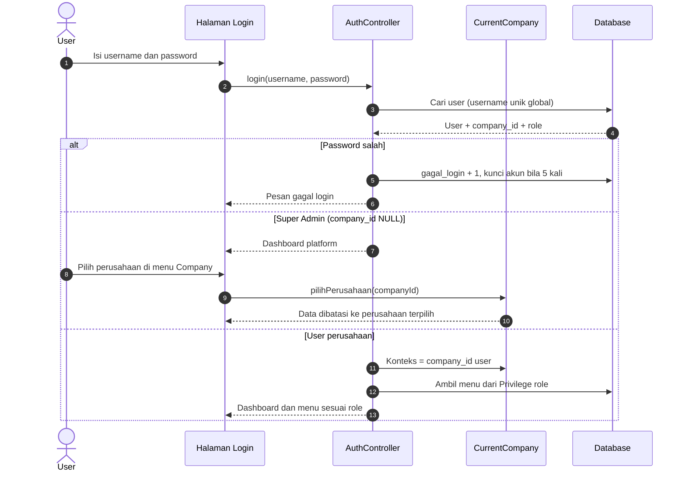

## 8. Sequence Diagram: Import CSV absensi, leave, dan lembur
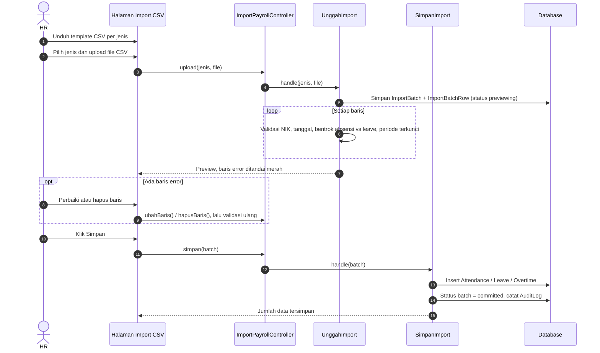

## 9. Sequence Diagram: Membuat dan memperbarui kontrak
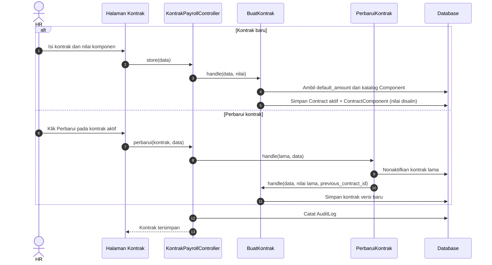

## 10. Sequence Diagram: Generate dan approval payroll
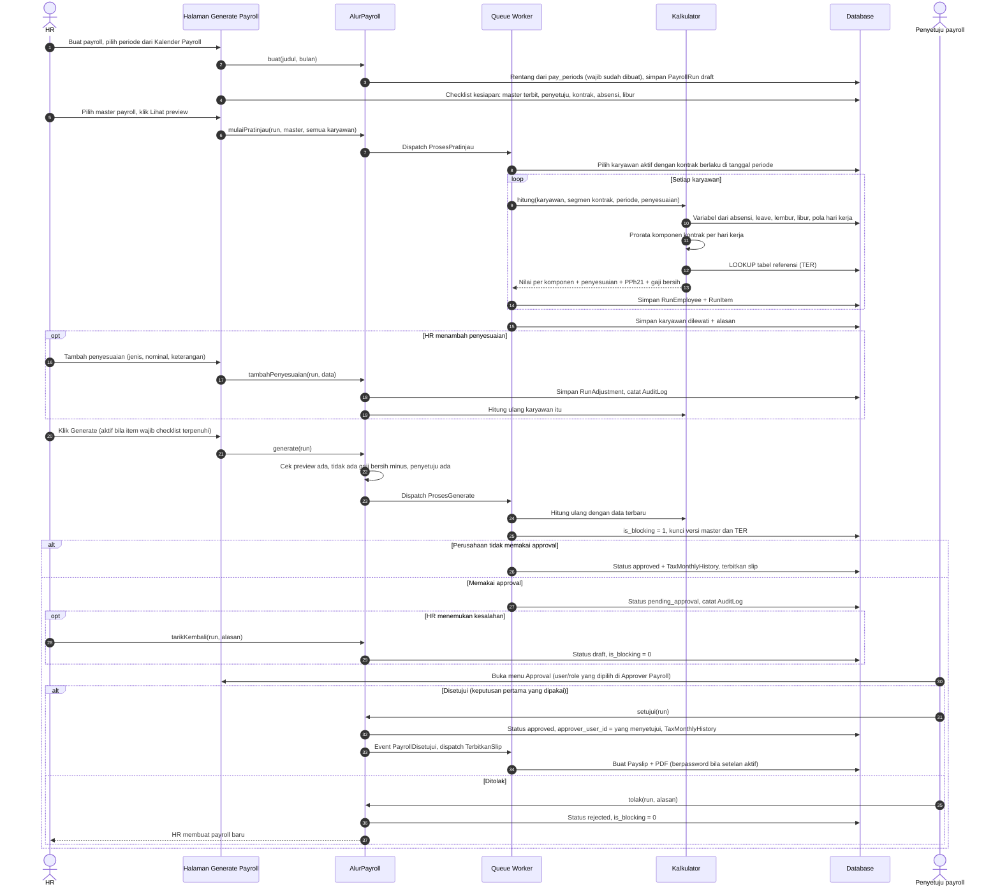

## 11. Sequence Diagram: Karyawan mengunduh slip gaji
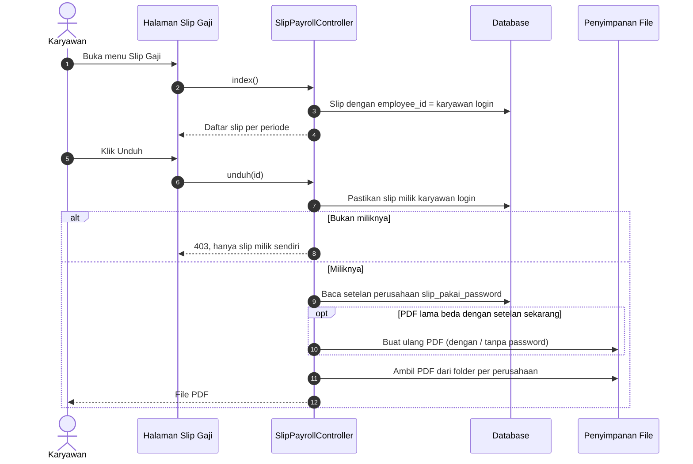

## 12. ERD (struktur database)

```mermaid
---
title: ERD Database Aplikasi Penggajian (Multi-Perusahaan)
---
erDiagram
  audit_logs {
    int id PK
    int company_id
    int user_id
    varchar action
    varchar entity_type
    int entity_id
    text old_values
    text new_values
    varchar ip_address
    datetime created_at
  }
  companies {
    int id PK
    varchar code
    varchar name
    text address
    varchar logo_path
    varchar signer_name
    varchar signer_title
    varchar signature_path
    bool is_active
    bool payroll_baru
    bool payroll_butuh_approval
    bool slip_pakai_password
    varchar prorata_dasar
  }
  departemen {
    int id PK
    varchar kode
    varchar nama
    int manager_id FK
    int company_id FK
    int pay_work_pattern_id FK
  }
  departemen_manager {
    int id PK
    int departemen_id FK
    int karyawan_id FK
    int company_id FK
  }
  karyawan {
    int id PK
    int departemen_id FK
    int pajak_id FK
    varchar nik
    varchar nama
    varchar jabatan
    date tgl_masuk
    varchar no_rekening
    varchar jenis_kelamin
    varchar email
    varchar telepon
    text alamat
    varchar nama_bank
    varchar status_kepegawaian
    int sisa_cuti
    bool is_active
    int company_id FK
    int position_id FK
    date resign_date
    bool has_npwp
    text npwp
    text bank_account_no
    int pay_work_pattern_id FK
  }
  menus {
    int id PK
    int parent_id FK
    varchar nama
    varchar url
    varchar icon
    int urutan
  }
  pajak {
    int id PK
    varchar status_ptkp
    decimal nilai_ptkp
    int golongan_ter_id FK
  }
  pay_attendances {
    int id PK
    int company_id FK
    int employee_id FK
    date attendance_date
    time check_in
    time check_out
    decimal late_hours
    int import_batch_id FK
  }
  pay_components {
    int id PK
    int company_id FK
    varchar code
    varchar name
    varchar type
    bool is_taxable
    bool is_contractable
    decimal default_amount
    bool is_active
  }
  pay_contract_components {
    int id PK
    int company_id FK
    int contract_id FK
    int component_id FK
    decimal amount
  }
  pay_contracts {
    int id PK
    int company_id FK
    int employee_id FK
    int previous_contract_id FK
    varchar contract_name
    date start_date
    date end_date
    bool is_active
    decimal info_thp
    int created_by FK
  }
  pay_holidays {
    int id PK
    int company_id FK
    date holiday_date
    int departemen_id FK
    varchar type
    varchar name
  }
  pay_periods {
    int id PK
    int company_id FK
    char period_month
    date start_date
    date end_date
    int created_by FK
  }
  pay_run_adjustments {
    int id PK
    int company_id FK
    int run_id FK
    int employee_id FK
    int component_id FK
    decimal amount
    varchar note
    int created_by FK
  }
  pay_work_patterns {
    int id PK
    int company_id FK
    varchar code
    varchar name
    varchar work_days
    bool is_default
  }
  pay_import_batch_rows {
    int id PK
    int company_id FK
    int batch_id FK
    int row_no
    text payload
    bool is_valid
    varchar error_message
  }
  pay_import_batches {
    int id PK
    int company_id FK
    varchar type
    varchar file_name
    int total_rows
    int valid_rows
    varchar status
    int created_by FK
    datetime committed_at
  }
  pay_items {
    int id PK
    int company_id FK
    int master_version_id FK
    int component_id FK
    varchar code
    varchar name
    varchar type
    bool is_taxable
    varchar calc_type
    text formula
    varchar item_role
    int sort_order
  }
  pay_leave_types {
    int id PK
    int company_id FK
    varchar code
    varchar name
    bool is_active
  }
  pay_leaves {
    int id PK
    int company_id FK
    int employee_id FK
    int leave_type_id FK
    date leave_date
    varchar note
    int import_batch_id FK
  }
  pay_master_versions {
    int id PK
    int company_id FK
    int master_id FK
    int version_no
    varchar status
    varchar note
    datetime published_at
    datetime locked_at
    int created_by FK
  }
  pay_masters {
    int id PK
    int company_id FK
    varchar code
    varchar name
    varchar description
    int current_version_id FK
    bool is_active
  }
  pay_overtimes {
    int id PK
    int company_id FK
    int employee_id FK
    date overtime_date
    decimal duration_hours
    varchar note
    int import_batch_id FK
  }
  pay_params {
    int id PK
    int company_id FK
    int master_version_id FK
    varchar code
    varchar name
    decimal value
  }
  pay_payslips {
    int id PK
    int company_id FK
    int run_employee_id FK
    int employee_id FK
    varchar file_path
    datetime generated_at
    varchar note
  }
  pay_period_configs {
    int id PK
    int company_id FK
    int start_day
    int end_day
    bool start_in_previous_month
  }
  pay_positions {
    int id PK
    int company_id FK
    varchar code
    varchar name
    bool is_active
  }
  pay_reference_table_rows {
    int id PK
    int company_id FK
    int version_id FK
    varchar key_value
    decimal range_from
    decimal range_to
    decimal result_number
    varchar result_text
    int sort_order
  }
  pay_reference_table_versions {
    int id PK
    int company_id FK
    int reference_table_id FK
    int version_no
    varchar status
    date effective_from
    datetime published_at
    datetime locked_at
    int created_by FK
  }
  pay_reference_tables {
    int id PK
    int company_id FK
    varchar code
    varchar name
    varchar description
    bool is_active
  }
  pay_run_employees {
    int id PK
    int run_id FK
    int company_id FK
    int employee_id FK
    int contract_id FK
    date period_start
    date period_end
    bool is_blocking
    varchar employee_no
    varchar nik
    varchar full_name
    varchar department_name
    varchar position_name
    varchar ptkp_status
    varchar bank_name
    text bank_account_no
    text variables_snapshot
    decimal total_earnings
    decimal total_deductions
    decimal gross_taxable
    decimal take_home_pay
  }
  pay_run_items {
    int id PK
    int company_id FK
    int run_employee_id FK
    int payroll_item_id FK
    int component_id FK
    varchar code
    varchar name
    varchar type
    bool is_taxable
    int sort_order
    decimal calculated_amount
    decimal final_amount
    bool is_overridden
  }
  pay_run_reference_versions {
    int run_id PK, FK
    int reference_table_id PK, FK
    int reference_version_id FK
  }
  pay_runs {
    int id PK
    int company_id FK
    varchar title
    date period_start
    date period_end
    int master_version_id FK
    varchar employee_scope
    text employee_selection
    varchar status
    varchar job_type
    varchar job_status
    text job_error
    datetime job_started_at
    datetime job_finished_at
    text skipped_employees
    int created_by FK
    int approver_user_id FK
    datetime generated_at
    datetime approved_at
    datetime rejected_at
    varchar reject_reason
  }
  pay_tax_monthly_histories {
    int id PK
    int company_id FK
    int employee_id FK
    int run_id FK
    int tax_year
    int tax_month
    varchar ter_category
    decimal ter_rate
    decimal gross_taxable
    decimal pph21
  }
  pay_variables {
    int id PK
    int company_id FK
    int master_version_id FK
    varchar code
    varchar name
    varchar kind
    varchar source
    text filter_expression
    varchar value_expression
    varchar aggregate
    text formula
    int sort_order
  }
  privileges {
    int id PK
    int role_id FK
    int menu_id FK
    bool can_view
    bool can_create
    bool can_update
    bool can_delete
    bool can_approve
    int company_id FK
  }
  roles {
    int id PK
    varchar nama
    int company_id FK
  }
  users {
    int id PK
    int role_id FK
    int karyawan_id FK
    varchar username
    varchar email
    bool is_active
    int gagal_login
    bool is_locked
    datetime last_login
    int company_id FK
    int approver_user_id FK
  }
  karyawan ||--o{ departemen : "manager_id"
  companies ||--o{ departemen : "company_id"
  karyawan ||--o{ departemen_manager : "karyawan_id"
  departemen ||--o{ departemen_manager : "departemen_id"
  pay_positions ||--o{ karyawan : "position_id"
  companies ||--o{ karyawan : "company_id"
  departemen ||--o{ karyawan : "departemen_id"
  pajak ||--o{ karyawan : "pajak_id"
  menus ||--o{ menus : "parent_id"
  pay_import_batches ||--o{ pay_attendances : "import_batch_id"
  karyawan ||--o{ pay_attendances : "employee_id"
  pay_components ||--o{ pay_contract_components : "component_id"
  pay_contracts ||--o{ pay_contract_components : "contract_id"
  users ||--o{ pay_contracts : "created_by"
  pay_contracts ||--o{ pay_contracts : "previous_contract_id"
  karyawan ||--o{ pay_contracts : "employee_id"
  companies ||--o{ pay_contracts : "company_id"
  pay_import_batches ||--o{ pay_import_batch_rows : "batch_id"
  users ||--o{ pay_import_batches : "created_by"
  pay_components ||--o{ pay_items : "component_id"
  pay_master_versions ||--o{ pay_items : "master_version_id"
  pay_import_batches ||--o{ pay_leaves : "import_batch_id"
  pay_leave_types ||--o{ pay_leaves : "leave_type_id"
  karyawan ||--o{ pay_leaves : "employee_id"
  users ||--o{ pay_master_versions : "created_by"
  pay_masters ||--o{ pay_master_versions : "master_id"
  pay_master_versions ||--o{ pay_masters : "current_version_id"
  companies ||--o{ pay_masters : "company_id"
  pay_import_batches ||--o{ pay_overtimes : "import_batch_id"
  karyawan ||--o{ pay_overtimes : "employee_id"
  pay_master_versions ||--o{ pay_params : "master_version_id"
  karyawan ||--o{ pay_payslips : "employee_id"
  pay_run_employees ||--o{ pay_payslips : "run_employee_id"
  pay_reference_table_versions ||--o{ pay_reference_table_rows : "version_id"
  users ||--o{ pay_reference_table_versions : "created_by"
  pay_reference_tables ||--o{ pay_reference_table_versions : "reference_table_id"
  companies ||--o{ pay_reference_tables : "company_id"
  pay_contracts ||--o{ pay_run_employees : "contract_id"
  karyawan ||--o{ pay_run_employees : "employee_id"
  pay_runs ||--o{ pay_run_employees : "run_id"
  pay_components ||--o{ pay_run_items : "component_id"
  pay_items ||--o{ pay_run_items : "payroll_item_id"
  pay_run_employees ||--o{ pay_run_items : "run_employee_id"
  pay_reference_table_versions ||--o{ pay_run_reference_versions : "reference_version_id"
  pay_reference_tables ||--o{ pay_run_reference_versions : "reference_table_id"
  pay_runs ||--o{ pay_run_reference_versions : "run_id"
  companies ||--o{ pay_periods : "company_id"
  departemen ||--o{ pay_holidays : "departemen_id"
  pay_work_patterns ||--o{ departemen : "pay_work_pattern_id"
  pay_work_patterns ||--o{ karyawan : "pay_work_pattern_id"
  companies ||--o{ pay_work_patterns : "company_id"
  pay_runs ||--o{ pay_run_adjustments : "run_id"
  karyawan ||--o{ pay_run_adjustments : "employee_id"
  pay_components ||--o{ pay_run_adjustments : "component_id"
  users ||--o{ pay_run_adjustments : "created_by"
  users ||--o{ pay_runs : "approver_user_id"
  users ||--o{ pay_runs : "created_by"
  pay_master_versions ||--o{ pay_runs : "master_version_id"
  companies ||--o{ pay_runs : "company_id"
  pay_runs ||--o{ pay_tax_monthly_histories : "run_id"
  karyawan ||--o{ pay_tax_monthly_histories : "employee_id"
  pay_master_versions ||--o{ pay_variables : "master_version_id"
  roles ||--o{ privileges : "role_id"
  menus ||--o{ privileges : "menu_id"
  companies ||--o{ roles : "company_id"
  users ||--o{ users : "approver_user_id"
  karyawan ||--o{ users : "karyawan_id"
  roles ||--o{ users : "role_id"
  companies ||--o{ users : "company_id"
```
